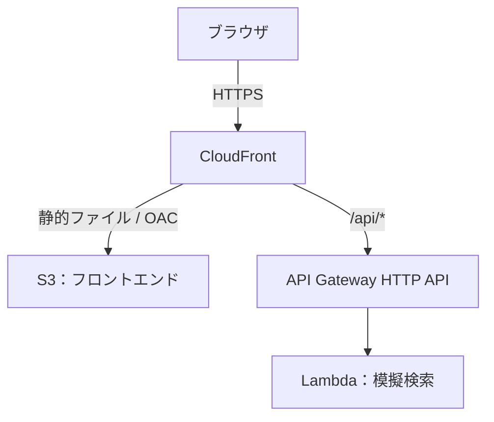

# Book_Search_Demo

AWSの資格学習で学んだ構成を実際に構築し、Terraformによるインフラ構築・管理への理解を深めるために制作した書籍検索デモです。

複数サイトの検索を模擬し、ダミーデータの検索結果をまとめて表示します。実際のスクレイピングは行いません。

- [デモアプリ](https://d5qlnf7lo0m3y.cloudfront.net)
- [解説記事 (Zenn)](https://zenn.dev/kazs1000/articles/c5ba1c0cc00018) — 設定の意味や構築中の学び、検証結果を紹介しています。

## 使用技術


## 構成



CloudFrontの同一ドメインから静的ファイルとAPIを配信します。ログ・監視を含む構成の詳細はブログに記載しています。

## 主な実装内容

- **インフラ管理**：TerraformでAWSリソースを管理し、StateをS3に保存。
- **アクセス制御**：S3への読み取りをOACとバケットポリシーで対象CloudFrontに許可。API GatewayからのLambda呼び出し許可を対象のステージ・メソッド・パスに限定。
- **ログ・監視**：CloudFrontのログをS3、API Gateway・LambdaのログをCloudWatch Logsに保存。CloudWatchアラームとSNSでメール通知。
- **流量・費用管理**：APIのスロットリング、Lambdaの予約済み同時実行数5、AWS Budgetsによる予算通知を設定。

## ディレクトリ構成

| パス | 内容 |
|---|---|
| `frontend/` | 画面・API呼び出し・検索結果の表示 |
| `api/` | Lambdaハンドラー・模擬検索・ダミーデータ |
| `terraform/` | AWSインフラの定義 |
| `local_server.py` | ローカルでの動作確認用サーバー |

## ローカルでの実行

Python 3.12を用意し、リポジトリのルートで実行します。追加パッケージやAWS認証は不要です。

```bash
python3 local_server.py
```

ブラウザで [http://localhost:3000](http://localhost:3000) を開いてください。

DockerとVS CodeのDev Containers拡張機能を利用する場合は、リポジトリを開き、`Dev Containers: Reopen in Container` を実行してください。Python 3.12・Terraform・AWS CLIを利用でき、ポート3000を転送します。

AWS上のリソースを操作する場合は、コンテナ内でご自身のAWS認証を設定してください。ホストの認証情報は自動でマウントしません。
