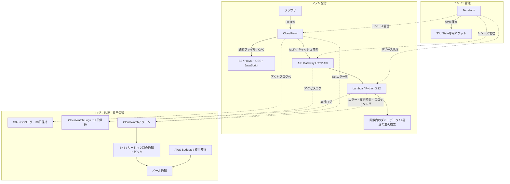

# Book Search Demo — 古本検索

AWSとTerraformの学習を目的に作成した、架空の書店2サイトを横断検索するデモアプリです。
書籍・価格・在庫・商品リンクはダミーで、実在サイトへのスクレイピングは行いません。

デモURL・解説ブログ：公開準備中。

## 主な機能

- 書名・著者名の検索と、2サイトの結果の統合表示
- 価格・在庫・サイト名・検索所要時間の表示
- 並列検索と、エラー・タイムアウト時の部分成功

## 構成・使用技術



実線はリクエスト・通知・State保存、点線はログ・メトリクス・リソース管理の流れです。Terraformは図の配信・監視リソースを管理します。State用S3は別に準備する構成です。

基本リージョンは東京（`ap-northeast-1`）。CloudFrontのログ配信リソース、アラームとその通知先SNSは `us-east-1` に配置します。

| 領域 | 使用技術・役割 |
| --- | --- |
| フロントエンド | HTML / CSS / JavaScript。S3に配置し、CloudFrontから配信 |
| API | API Gateway HTTP APIでルーティング・流量制御、Lambdaで検索処理 |
| 並列検索 | Python 3.12 / asyncio。サイトごとにタイムアウトと例外を処理 |
| 配信・保護 | CloudFrontのHTTPS・静的キャッシュ・セキュリティヘッダー、OACとIAMによる権限制御 |
| ログ | CloudWatch LogsにAPI・実行ログ、専用S3にCloudFrontアクセスログ |
| 監視・費用管理 | CloudWatchアラームからSNSメール通知、AWS Budgetsで費用通知 |
| インフラ管理 | Terraformで構成をコード化し、S3 backendでStateを管理 |

### この構成を選んだ理由

| ポイント | 理由 |
| --- | --- |
| CloudFrontで入口を統一 | 静的ファイルとAPIを同一オリジンで利用し、パスごとに転送先を分けるため |
| 非公開S3とOAC | フロント用ファイルをS3から直接公開せず、CloudFront経由で配信するため |
| API GatewayとLambda | ルーティング・流量制御・アクセスログと検索処理の役割を分け、API管理を学ぶため |
| 単一Lambda内の並列検索 | 構成を抑えながら、複数サイトの応答待ちと部分失敗を再現するため |
| ログ・監視・通知 | アクセス状況を調査し、実行エラー・遅延・配信エラーを検知するため |
| TerraformとS3 State | インフラをコードで再現し、管理状態を継続して保持するため |

設定値や構築手順の詳細は、公開予定のブログで解説します。

## ローカル起動

Python 3.12を用意し、リポジトリのルートで実行します。追加パッケージは不要です。

```bash
python3 local_server.py
```

[http://localhost:3000](http://localhost:3000) を開き、`terraform`、`aws`、`python` などで検索できます。

## 現在の制約・今後の予定

- 現在はdev環境のみ。認証やデータの永続化はありません。
- API Gatewayの既定エンドポイントも有効です。
- 今後はGitHub Actions / OIDC、Terraformモジュール分割、環境分離、APIキャッシュを検証予定です。
